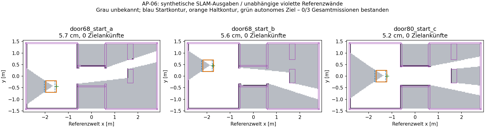

# AP-06 – Originalnachweise, 03.–04.10.2026

**Gesamt-/Realabnahme offen.** Die Softwarekorrekturen sind gebaut und ihre Regressionen bestanden. Der endgültige geschlossene Produktstack besteht **0/3 Positivmissionen**: autonome erste Anfahrt, danach `start_egress_reference_expired`, terminal `blocked_help_required`, keine Zielankunft oder bestätigte Beobachtungsaufgabe. Das ist kein AP-06-Abschluss. Maßgeblicher aktueller Iststand: [STATUS](../../STATUS.md).

Basis `6a4a7df51c3ed152edb82ffa8b7dce5f1020f8e4`, Branch `feature/ap06-closed-product-validation`. Geprüfter Software-/Prüfstandcommit **`ecb2586`**, auf den begrenzten Reparaturen bis `64fd894` und den vorab festgelegten Manifesten. Dokumentations-/Nachweiscommit kommt anschließend. [Quellmanifest](source_manifest.json) enthält vollständige SHA, Quellhashes und die bytegleichen MASTERPLAN-/Originalmanifesthashes. Keine Veröffentlichung, Geräteinstallation oder reale Fahrt.

## Endgültige vollständige Läufe

[Maschinenlesbare Ergebnisse](complete_results.json), [Originalkommandos](ap06-complete-case-commands.json), [Ausführung](ap06-complete-cases.log). Alle festen Startposen, Wände, Mastmaske, Konturen und Fristen erhalten. 60 s jeweilige Bereitschaftsprüfung, 900 s Mission, 150 s Aufgabe, 20 Aufgaben/3 Fehler; kein Budgetreset. Keine manuell vorgegebenen Navigationsziele.

| Lauf | Tatsächliches Ergebnis | Fahrstrecke | Ankunft / Beobachtung | Referenzboden beobachtet | Max. Wandfehler |
|---|---|---:|---:|---:|---:|
| `complete-a`, 68 cm, −1,9/−0,45/0 | blocked / Referenz abgelaufen | 5,748 cm | 0 / 0 | 54,877 % | 2,492 cm |
| `complete-b`, 68 cm, −2,1/+0,45/0 | blocked / Referenz abgelaufen | 5,647 cm | 0 / 0 | 56,859 % | 2,491 cm |
| `complete-c`, 80 cm, −1,6/0/0 | blocked / Referenz abgelaufen | 5,180 cm | 0 / 0 | 57,437 % | 2,493 cm |
| `complete-cancel` | echter Mission-Cancel bestanden | 3,486 cm | keine Positivmission | getrennt im JSON | getrennt im JSON |
| `complete-gyro-hold` | HOLD/Stillstand-Zusatzfall bestanden; Mission failed / `hwt_terminal` | 4,876 cm | keine Positivmission | getrennt im JSON | getrennt im JSON |

Cancel: terminal nach **0,204 s**, gemessener Stillstand nach **0,331 s** ab Injektion; Grenzen 3/1 s. Gyrotransport tatsächlich 450 ms unterbrochen, HOLD beobachtet, Stillstand **0,242 s nach HOLD**, **0,561 s ab Injektion**. `hold_resume_qualified:false`: kein Fortsetzungs-/ACK-/Resume-Positivnachweis, keine vierte/fünfte bestandene Erkundungsmission.

Bei allen fünf Endläufen eindeutig `map→odom` aus `slam_toolbox`, `odom→base_link` aus `hwt601_mapping_ekf`; nativer C++-DDS-Prüfer korreliert wirkliche Publisher-GIDs. Maximal ein NavigateToPose-Kind und ein ExploreArea-Elternziel; terminal keine aktiven Handles, alle vier Befehlsstufen exakt null. Unabhängige volle gepaddete Kontur kollisionsfrei. Kein Wahrheits-TF/-Kartenpublisher im Gesamtstack.

Das Bild zeigt echte SLAM-Ausgaben aus dem Modell, keine realen Raumdaten. Die violette Referenz wird ausschließlich vom unabhängigen Prüfer genutzt. Kumulative neue Karte allein ist keine erledigte Beobachtungsaufgabe und kein Erfolg.

**Erstes fehlgeschlagenes Kriterium:** Die erste vollständige nützliche autonome Beobachtung fehlt. Der vorhandene Schutz entzieht während der tatsächlichen SLAM-Aktualisierung die feste Startreferenz; Nav2 wird gecancelt. In C ist das Ausgangsfingerprint identisch zur gesicherten stationären Messkarte, der Rasterursprung verschiebt sich danach um −1,985 mm / −0,066 mm. Alte unbekannte Konturzellen werden anschließend nicht freigegeben. Origin-/Referenzänderung, Körpermaskenverfall und Originalinventar bleiben geschützt; kein stilles Re-Ankern oder Ausschalten des Prädikats.

**Kleinstes weiteres AP-06-Arbeitspaket:** Aktuelle SLAM-Raster-/Referenzänderungen und den ersten festen unbekannten Egress-Bestand geometrisch konsistent verbinden; alte Pfadbindung invalidieren, neue ganze Fahrzeugprüfung auf frischen Daten begründen, ohne neue Freiraumannahme, Wiederbetretung oder Budgetreset. Zuerst den gesicherten bewegungsabhängigen Gegenfall reparieren, dann dieselben drei Gesamtmissionen erneut. Erst danach Zielsystem-/LAB-1-Abnahme. Keine AP-07-Arbeit.

## Tatsächlich geprüfter Stack

Unveränderte vorhandene Mission-Manager-/C++-BT-/Explorer-Auftragskette, echter Nav2 NavigateToPose/NavFn/RPP, Fahrtor, Velocity Smoother, Collision Monitor; nativer EKF und gepatchter synchroner SLAM. Endläufe enthalten zusätzlich **echte `ScanVereinheitlichen`- und `SafetyMonitor`-Knoten**. Welt liefert `/scan`, endliche 3-D-Kegel-/Tiefenreturns, absolut gemessene Modell-Motorzähler und HWT-FC03-Rohregister sowie allein die Schalteranforderung `/safety/estop_request`.

Originale HWT-Transport-/CRC-/Messzeit-/800-Sample-Bias-/Quellenprüfungen und Encoder-/Watchdogentscheidungen berechnen ihre eigenen Zustände. VL53-Qualitäts-/Matrix-/Wolkenmethoden werden unverändert aus dem installierten Produkt geladen; ausschließlich der I2C-Endpunkt wird modelliert. Kamera idealisiert 8×16, VL53 8×8; endliche Verdeckung mit Boden/Wänden/Decke. Kein USB, optische Störung, reale Motorträgheit oder physischer Not-Aus-Nachweis. Produktionsstatusfelder `synthetic:false` qualifizieren dieses ausdrücklich deklarierte Modell nicht als Hardware. Das Safety-Log warnt selbst vor fehlender physischer GPIO-/Not-Aus-Anbindung.

Modelldynamik: 50-ms-Antwort, zeitlich geordnete Registeränderungen, Integration in ≤10-ms-Schritten; Verzögerungen/Quellenlücken protokolliert, keine aufgefüllten/rückdatierten Proben. Diese Trackinggrenzen gelten ausschließlich für das Modell. Hardware-Rampen, tatsächliche Last und Buswechsel bleiben offen.

### Manifestentwicklung und erhaltene Negativbelege

- `741e7cc`: ursprüngliche Szenarien vor erster Mission; `f61ee85`: native CW-Maske 236–304° / ROS 56–124° getrennt dokumentiert. Original-SHA `1a1d91e1fc2d5a822fc8956ab1ae3a2860053aca4107d8bcbb7488565ab086f1` bleibt erhalten.
- `342af24`: 2160-Strahl-Dichteprofil vor erstem entsprechenden Lauf, nur Dichte geändert. Ursprüngliches 720-Strahl-Profil bleibt bytegleich; keine Startpose/Abnahme nachträglich verschoben.
- `0f95424`: vollständige ursprüngliche Costmap-Layer, rollende lokale Karte und deklarierte endliche VL53-/OAK-Modelle vor deren erstem Lauf. Fehlende Wahrnehmung/Layers in früheren Prüfständen offen korrigiert.
- Frühere `native-*`, `native2160-*`, `product-*` und `final-*` bleiben im Archiv. Sie zählen wegen Setupfehlern, Diagnoseprofilen, statischen Costmaps oder noch fehlenden echten Scan-/Safety-Knoten nicht als endgültige vollständige Abnahme. Nur `complete-*` bezeichnet die letzten vollen Läufe. Alle ursprünglichen negativen Ergebnisse bleiben negativ.

## Reparaturen und Regressionen

| Korrektur | Originalgegenfall / Nachweis |
|---|---|
| `7d42ba4`: TF zur aktuellen ROS-Zeit statt zukünftiger SLAM-Latest-TF; unveränderte Frische-/Planargrenzen | echte TF2-Buffer-Gegenfälle in `ap06-tf-regression.log` |
| `7d42ba4` / `46ee9ed`: identische stationäre Egress-Prüfungen nur je Kandidatenpass memoisiert, vollständige Eingaben/Geometrie im Schlüssel; kein Gesundheits-/Zeitcache | Originalprofile: 5,439 s / 96 Routen → 2,474 s / 168; End-to-end Budgets nicht gelockert |
| `46ee9ed`: Endpoint-only prüft den wirklichen Zielkörper statt nochmals den unexemptierten Start; Abfahrt/Ankunft getrennt | `ap06-rpp-egress-red.log`, `ap06-egress-regression-final-2.log` |
| `b315811`: Parent-Abbruchgrund beim Planen erhalten, selbst wenn Quelle zwischenzeitlich heilt; Vororientierung/Proof am wirklichen interpolierten 0,4-m-RPP-Carrot | rote Abbruch-/Rasteranschlussfälle, `ap06-planning-stop-red.log`, `ap06-carrot-red.log`; 90 betroffene grüne Fälle |
| `37c9a2e`: begrenzte VL53-Räumendpunkte dürfen keine Hindernisse markieren; echte Messwolken markieren weiterhin | echter nativer Nav2-Gegenfall **452→0** falsch markierte Zellen; nahe Wand weiterhin **394** Zellen; `ap06-costmap-{red,green}.log`, zwei YAML-Quellenregressionen |
| `0b002ac` / `64fd894`: begrenzte nahe Startbeobachtung aus aktueller Pose/Karte/Sicht, nur mit vollem Egress-/Zielbeweis; erste nützliche Position beendet zusätzliche Suche | tatsächlich gemessene synthetische Startkarte: vorher nur unbewiesener Vorschlag; rote Komponente `ap06-start-pocket-red.log`, danach 95 Fälle grün; neue Wand / fehlende Sicht sperren; B-Fristnegativfall erhalten, Endläufe A/B/C fahren an |
| Testregistrierung Mission-Manager, VL53, Safety und DDS-Testbarriere | tatsächliche Pytestfälle gesammelt; kein bloßer unittest-discover-Erfolg, keine gelockerte 180-ms-Radfrische |

Die Nahbereichszähler heißen im Original-JSON `*_lethal_cells`; gemessen werden
publizierte Costmapwerte ≥99 einschließlich Inscribed-/Inflationszellen. Die
452/394 sind Rasterzähler, keine Zahl direkter Sensorreturns.

## Build, Tests und Plattformen

| Prüfung | Ergebnis / Originalausgabe |
|---|---|
| 17 native Supportpakete frisch gebaut, 14 gepinnte AP-03-Nav2-Pakete als Unterlay wiederverwendet | `ap06-support-build.log`, 10 min 16 s; BT.CPP/BT.ROS/SLAM/EKF/Nav2-BT/Smoother/Collision |
| 9 ursprüngliche Produktpakete frisch, einschließlich echter C++-BT-Kompilation | `ap06-product-build.log`, 57,7 s, BT 32,7 s |
| später VL53 / Safety / Scan ergänzt; abschließender isolierter Zwölfpaketbuild | `ap06-closure-twelve-build.log`, 6,41 s; letzter Build inkrementell |
| native TF-GID-Probe | `ap06-tf-probe-build.log` |
| vollständige direkte betroffene Pytest-Auswahl inkl. Weltmodell | **1.844 bestanden**, 38,79 s, `ap06-final-affected-tests.log` |
| reguläre colcon-Auswahl zwölf Pakete | **1.836 Tests**, 0 Fehler / Failures / Skipped, `ap06-final-colcon-result.log` |
| native Bewegungsregression der geänderten Vororientierung | **8/8**: 68/80 cm, Umweg, zu eng, unzulässige Drehung, unbekannter Außenbereich, Bootstrap, blinder Start; `ap06-motion-regression.log` |
| native VL53/Costmap-Komponente | Rot/Grün oben, kein Motor-/Actionknoten; wahre nahe Hindernisse bleiben markiert |

Mengen überlappen; upstream BUILD_TESTING war ausgeschaltet, keine fremden Unit-Tests oder C++-BT-Unit-Tests als bestanden behauptet. Remote-CI wurde nicht ausgeführt; Auswahl/Trigger einschließlich nativer Nahbereichsgegenprobe ergänzt.

Beide Plattformen Ubuntu 22.04/Humble/amd64/Python 3.10.12, Docker **network none**, keine Geräte. Native Gesamt-/Bewegungs-/Costmap-Läufe und C++-Build: rclpy **3.3.17**, rclcpp 16.0.15, rcl 5.3.10 (ROS-Paketstand 20251008). Vollständige Komponenten-/colcon-Regression: rclpy **3.3.22**, rclcpp 16.0.21, rcl 5.3.13 (20260907). Keine Behauptung eines aktuellen ARM-/Jetson-Gesamtbuilds. [Isolierung](ap06-container-isolation.json), [native Identität](ap06-native-identity.json), [aktuelle Testidentität](ap06-current-identity.json): **135** installierte Produktdateien bytegleich, echte AP-06-Nachrichtenbindings, aufgelöste Modulpräfixe und Binär-SHAs.

Ältere vollständige colcon-Probe auf 3.3.17: 1/1.736 Fehler im passiven DDS-Timingfall, Mission-Manager zunächst nicht registriert. Originalausgaben und alter JUnit-Baum erhalten; 180-ms-Grenze nicht gelockert. Auf 3.3.22 vollständig grün. Fehlerhafte erste Aufrufauswahl (`robot_interfaces/test` existiert nicht) sammelte null Tests; nach Korrektur regulär geprüft. Erster colcon-Lauf entdeckte fehlende Safety-/Scan-Präfixe, anschließend beide wirklich gebaut und alle zwölf erneut geprüft. Diese Fehlversuche sind keine grünen Testläufe.

## Speichern und Grenzen

Alle fünf Endläufe speichern über den **echten Kartenmanager** eine synthetische Rohkarte. Vier echte Karte-/Checkpoint-Paare anschließend passiv mit den unveränderten Repository-/Schema-/Prüfsummen-/Fingerprintfunktionen geladen: A/B/C/Cancel. Gyro-HOLD meldet ehrlich `metric_checkpoint_exact_saved_snapshot_unavailable`, keine komplette Sicherung. [Passiver Nachweis](ap06-complete-checkpoint-load.json). Kein Lade-/Restore-Motorkommando, keine aktive Relokalisierung/Wiederaufnahme; `resume_authorizes_motion:false`.

**Offen:** drei vollständige positive Missionen, ≥3 erreichte/neu beobachtete Aufgaben, ganze Passage samt Heck, Weitererkundung, Kartenabschluss ≥95 % im Referenzbenchmark, fortgesetzter HOLD/ACK-/Resume-Lauf, reproduzierbarer ARM-Zielbuild, aktive echte Verbraucherlast/Busbesitzerwechsel, LAB-1-Kaltstart/Rundweg/WE-M6 zwei Positivläufe und reale WE-M5-Wiederaufnahme. Native iOS-WE-M7-Prüfung separat mangels Apple-Plattform offen.

User-App kennt lokales Projekt `/home/p/roboter_ws`; tatsächliches Befehlswerkzeug liefert x86_64/Debian 13/`/workspace`, keinen Jetson-Modellpfad, keine Gerätealiases und keinen lokalen Projektpfad. Ein Terminal-Anbindungsversuch lieferte ebenfalls Cloud-Kontext; letzte Terminalabfrage: kein zugeordneter lokaler Terminalkanal. Cloud-Konfiguration ohne VPN/TCP-Ziel/Robotercredentials. [Ausführungsbefund](ap06-execution-environment.json). Das ist eine technische Zielsystemgrenze, keine fehlende neue LAB-1-Freigabe. Auch bei verfügbarem Zugang sperrt der negative Gesamtsoftwarefall eine reale Abnahmefahrt.

## Archive / Reproduktion / Rückfall

- `ap06-native-evidence.tgz`: **sämtliche** ursprünglichen synthetischen Gesamtläufe, Sensor-/Quellen-/BT-/Nav2-/SLAM-/Safety-/Normalizerlogs, veröffentlichte echte Pläne, Befehle, Planttrace, Profile, Karten und Sidecars; zusätzlich acht native Bewegungsfälle und Rot/Grün-Costmap-Komponente.
- `ap06-junit-evidence.tgz`: letzte echte JUnit-Ausgaben plus erhaltene alte negative JUnit-Ausgaben. Nicht zusammen als eine Testmenge zählen.
- `logs/`: Original-Build-/Test-/Zwischenausgaben, inklusive Fehlschläge; JSONs/Skripte/Kommandos neben diesem README. `SHA256SUMS` schützt alle Belege.
- Quellen/Buildaufrufe in [Prüfstandanleitung](../../../../tools/simulation/README_AP06.md), zehn öffentliche Archiv-SHAs/Pins und vorhandener Pure-Rotation-Patch. Quellenprüfung unter Host und Python 3.10 wirklich ausgeführt; vollständiger sauberer Neubuild aller 31 Fremdpakete nicht wiederholt. Alle Archive/Installbäume außerhalb Git; nur Pins/Belege hier.

Beispiel: Archive in ein **neues** Verzeichnis entpacken, `sha256sum -c SHA256SUMS`; aktive Prüfungen ausschließlich in dem isolierten Container mit `AP06_SIMULATION=1` ohne durchgereichte Geräte. Aktuelle Docker-Prüfprozesse geordnet einzeln beendet; keine Prozessgruppen-/Rechner-Abschaltung und keine Jetson-Wirkung. Eigene temporäre Container nach Sicherung gestoppt.

Rückfall nur eigene AP-06-Commits gezielt revertieren/isolierten Prüfstand abwählen. AP-01–05 und fremde Arbeit erhalten; keine Änderung von `main`, kein Push/Merge, dauerhafter Install-/Autostartwechsel. ROBOT_TRANSFER unverändert, weil keine tatsächliche Jetson-Wirkung. Ein Revert der Räumstrahlkorrektur stellt den dokumentierten alten Fehler wieder her.
