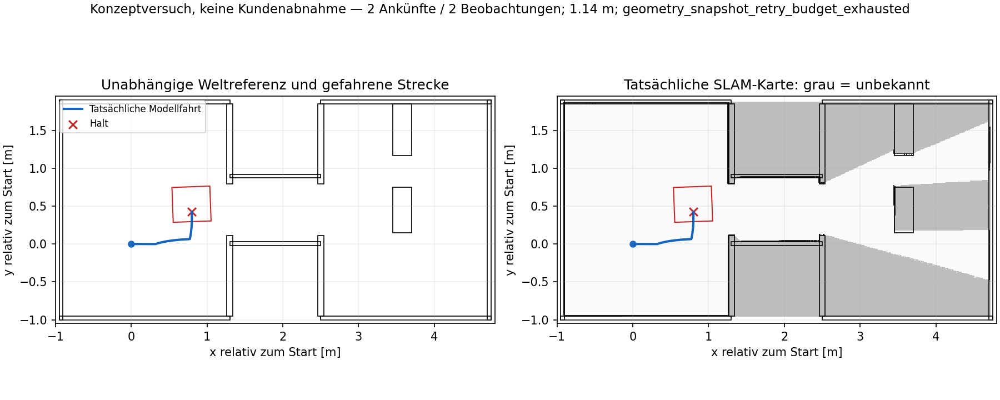

# AP-06: Konzeptvergleich vom 08.10.2026

Der Nutzer beauftragte, die Gesamtlösung praktisch auf Tragfähigkeit zu prüfen
und störende Blocker anhand ihrer Wirkung zu beurteilen. Diese Belege gehören
zu ausdrücklich veränderten Konzeptversuchen, nicht zur ursprünglichen
A/B/C-Abnahme. Hardware wurde nicht angesteuert. Der Nutzer übernimmt die
spätere lokale Ausführung auf dem Jetson.

**Lieferstand:** Produktkandidat `c5d2a9c`, Komponentenprüfungen bestanden,
Gesamtläufe weiterhin negativ. **Keine Kundenfreigabe, ursprüngliche AP-06-
Qualifikation weiterhin 0/3.** Die Softwareänderungen und ein passiver lokaler
Einstieg sind übertragbar; die funktionierende Gesamtlösung ist noch nicht
nachgewiesen. Anleitung: [JETSON_KONZEPTTEST_AP06](../../JETSON_KONZEPTTEST_AP06.md).

## Kandidaten und Vergleich

- Ausgangsprodukt: `2e5e1fd8d8f3241cbb3dfa9c2ee29988b036372f`.
- Getrennte Versuchssteuerung: `13ba945bc2e3b9aed399a836b27c8ec807f09e5b`.
- Drehphasen-Korrektur: `b0fa5eb2b5bef5d1066dcf92892a0830811f575e`.
- Start A, endliche 2160 Strahlen, gleiche Welt, Originalbudgets, native
  NavFn/RPP/SLAM/Manager/Explorer, vier CPU-Affinitäten 0/1/3/4. Keine manuell
  vorgegebenen Fahrziele oder freie Wahrheitspublizierung ins Produkt.
- Die geänderte Sensorvariante entfernt nur die simulierte Mastabschattung.
  Dies ist keine Anweisung, am realen Roboter dessen Scanfilter zu entfernen.

`product-identity.json` bindet die ersten beiden Läufe an unveränderte
Produktquellen und Installmodule. `phase-source-identity.json` und
`phase-native-identity.json` binden die Korrektur an 498 ausgeführte Dateien,
137 installierte Module und neun unveränderte native Binärartefakte. Original-
MASTERPLAN und Szenariomanifest sind unverändert gehasht.

| Versuch | Ankünfte / Beobachtungen | Fahrt | Beobachteter Referenzboden | Missionsende |
|---|---:|---:|---:|---|
| Endliche Sicht ohne Mastmaske (`visibility-a`) | 3 / 3 | 1,836 m | 73,34 % | `pose_stale_after_processing` |
| Zusätzlich Zukunftsnachweis zurückgestellt (`deferred-a`) | 3 / 3 | 1,317 m | 73,97 % | `failure_budget_exhausted` |
| Drehphase korrigiert, ursprünglicher Zukunftsnachweis (`phase-a`) | 2 / 2 | 1,245 m | 73,38 % | `map_status_join_retry_budget_exhausted` |
| Zusätzlich öffentliche Kartenfortsetzung bei leerem Privatbestand (`joined-a`) | 2 / 2 | 0,886 m | 69,19 % | `self_body_scan_stale_after_processing` |
| Begrenzte Frische-Wiederprüfung in Stillstandsphasen (`revalidation-a`) | 3 / 3 | 1,245 m | 73,79 % | `frontier_candidate_processing_budget_exhausted` |
| Gleicher Kandidat, zusätzliche Eingangs-/Zeitaufzeichnung (`selection-capture-a`) | 2 / 2 | 1,142 m | 71,89 % | `geometry_snapshot_retry_budget_exhausted` |

Die ersten beiden Läufe schaffen die zweite Tür einschließlich Heck nicht.
Kein Kollisionskontakt, positive gepolsterte Mindestabstände 7,34 bzw. 7,69 cm;
maximale Wandfehler 2,55 bzw. 1,50 cm. Terminal keine aktiven Explorer-/Nav2-
Actions und vier Nullkommandos. Karte gespeichert, exakter Checkpoint nach
beiden Fehlerenden nicht verfügbar. Ein Teilfortschritt ist kein Gesamtpositiv.

## Was die Experimente tatsächlich zeigen

Die endliche zusätzliche Sicht überwindet die frühere Startbarriere im Modell,
löst aber nicht die Gesamtmission. Die statische Strahlprüfung bestätigt,
dass fehlende Startzellen unter diesen veränderten Sichtbedingungen messbar
sind; sie ist selbst kein SLAM-Beobachtungsbeweis.

Im zweiten Lauf wurde der ursprüngliche Zukunftsnachweis achtmal aufgerufen
und einmal wirklich überbrückt. Die aktuelle öffentliche Kontur und der
unveränderte Controllervertrag waren dabei gültig. Die Fahrt begann, wurde
jedoch nach etwa 6 cm von der weiterhin wirksamen aktuellen Fahrprüfung mit
`footprint_sweep_invalid` gestoppt. Die Überbrückung hat den Erfolg nicht
hergestellt und wird deshalb nicht als Produktstandard übernommen.

Zwei andere Ausrichtungen scheiterten bei zuvor positivem ursprünglichem
Zukunftsnachweis. Je rund 19,6 s ergaben nur 0,061/0,083 rad Encoderrotation,
15 kurze Drehimpulse, über 73 % Nullkommandos. Alte Daten enthielten den
konkreten internen Ausrichtungsfehler nicht; `too_slow` bleibt dafür eine
Hypothese. Details und Quellhashes stehen im unabhängigen Audit.

Die neue Produktkorrektur prüft während externer Vorausrichtung den frischen
vollständigen öffentlichen Drehraum. Vor Fahrbeginn und während Navigation
bleibt die vollständige tatsächliche Streckenprüfung zuständig. Ohne vollen
Drehraumnachweis bleibt der alte Streckenprüfer als Rückfall. Quellen,
Geometrie-/Trackingreserven, Nutzerabbruch, Fristen und Fehlerbudgets bleiben
unverändert. Das tatsächliche Alignment-Tupel wird nun aufgaben- und
versuchsgebunden erhalten.

## Softwareprüfung

- Alter Originalgegenfall rot: sichere aktuelle Drehung wird durch entfernte
  spätere Blockade gestoppt. Korrigiert: Drehung möglich, Fahrbeginn weiterhin
  verweigert. Neue Hindernisse/Unknown am Drehort, aktives Nav2-Kind sowie
  Quellen-, Pose-, Kontext-, Cancel- und Fristfehler bleiben gesperrt.
- 39 gezielte Tests grün, darunter 14 neue Fälle im registrierten Bestandstest.
- Zwölf Pakete gebaut; 1.806 direkte Tests grün, 1.732 registrierte
  Explorer-Tests grün, jeweils keine Fehler/Skips. Die Mengen überschneiden
  sich und werden nicht addiert. Separat zuvor 74 Prüfstandstests grün.
- Native Fälle: 9/9 bestanden. Der neue geschlossene Lauf bleibt wie oben negativ; alle seine Ausrichtungen waren `controller_owned`. Er hat die neue externe Drehphase nicht praktisch ausgeübt.

## Nachvollziehbarkeit und Grenzen

Jeder Gesamtlauf bewahrt Resultat, Manifest, finale synthetische Raster,
Produktlogs und die Integritätsprüfung des komprimierten Ereignisstroms.
Große Rohtraces verbleiben lokal außerhalb Git; `local-raw-traces.json`
verzeichnet Ort, Größe und komprimierte SHA, die jeweiligen `.meta.json`
und `.verified.json` zusätzlich die dekomprimierte Integrität. `SHA256SUMS`
bindet die hier eingecheckten Belege. Eine neue Ausführung benötigt ein
neues Ausgabeverzeichnis und erzeugt neue Messungen, keine bitidentische
Wall-Clock-Trajektorie.

Ursprüngliche Qualifikation bleibt **0/3**, Hardwarequalifikation fehlt.
Die Übergabeanleitung und die echten Unterschiede zwischen Modell und
Jetson-Launch stehen in [KONZEPTVERSUCH_AP06](../../KONZEPTVERSUCH_AP06.md).

## Integration von Kartenbindung und lokalem Start

`876b595` korrigiert einen reproduzierten Fehler der öffentlichen Kartenfortsetzung:
Ein gültiger, aber vollständig leerer privater Startbestand verhinderte bisher
auch die bereits vorhandene öffentliche Fortsetzung. Nur wenn ursprüngliche,
retinierte und projizierte Privatbestände vollständig leer sind, darf ein
laufendes öffentliches Nav2-Kind die alte exakte Karten-/Statusbindung behalten.
Neue Rohkarten dürfen dabei nur Freiraum entziehen. Ursprüngliche Frischegrenzen,
Geometrieprüfung und der Ausschluss neuer Ziele/Beobachtungsbelege bleiben bestehen.
Fünf echte Gegenfälle waren vorher rot; danach bestanden 182 gezielte Tests.
Der ältere `phase-a`-Trace belegt leere Bestände, jedoch nicht den damaligen
exakten Ablehnungszweig. Die Korrektur beweist daher keinen rückwirkenden Grund
für sämtliche damaligen Kartenabbrüche.

Der Kandidat `e9f4506c596a133de1374ee1388eb1e9f14c457a` bindet 626 Quelldateien,
164 installierte Dateien und neun native Binärartefakte in `release/`.
14 Pakete gebaut; 1.865 direkte Tests und 1.757 registrierte Explorer-Tests
bestanden am integrierten Produkt vor der reinen Discovery-Korrektur am
Vorbereitungswerkzeug. Danach bestanden separat alle 24 Werkzeugtests und
alle neun nativen Nav2-Szenarien am genannten Kandidaten. Die Testmengen
überschneiden sich und werden nicht addiert.

`start_explorer:=false` erlaubt den vorhandenen Stack zunächst ohne Explorer.
Das passive Werkzeug `metric_scope_vorbereiten.py` bindet den ausdrücklich
geprüften LAB-Bereich an tatsächliche aktuelle Karte, Status, TF und
Quelleneigentümer. Ein realer ROS-Smoke auf x86 bestätigt private exklusive
Profilausgabe, unveränderte Ablehnung vorhandener Dateien und Ablehnung eines
vorhandenen ExploreArea-Endpunkts; alle Hilfsprozesse endeten. Diese drei
Werkzeugfälle sind ausdrücklich keine drei Gesamtmissionen. Frühere negative
Smoke-Versuche einschließlich RMW-Discovery-Metadaten und einer korrigierten
Prüfskriptannahme bleiben erhalten.

`joined-a` endet ebenfalls negativ. Der einzige aufgezeichnete Join-Receipt
(`no_active_child`) liegt rund 116 s vor dem Fehler; `map_join_stop` ist leer.
Er ist keine Abbruchursache. Alle Alignment-Receipts sind `controller_owned`.
Der Scan war bei Auswahl gültig und nach Verarbeitung älter als 0,5 s;
die ursprüngliche Empfangszeit und einzelne Verarbeitungsdauern fehlen im
Trace. Weder ein Sensorausfall noch eine CPU-Laufzeit von über 0,5 s ist daraus
bewiesen. Keine aktive Action und vier Nullkommandos am Ende, Karte gespeichert,
exakter gespeicherter Checkpoint nicht verfügbar. Die beiden Türen wurden
nicht vollständig durchfahren.

## Begrenzte Wiederprüfung statt Ende bei abgelaufener Berechnung

`d038d4dc73b659360ce72f6accd12bbdf38d0077` erweitert ausschließlich die
bereits vorhandene Wiederprüfung eines laufenden Auftrags nach terminalem
Kind und bestätigtem Stillstand um `pose_stale_after_processing` und
`self_body_scan_stale_after_processing`. Der abgelaufene Datensatz wird
verworfen. Eine erneute vollständige Eingangs- und Streckenprüfung ist nötig;
Zeitgrenzen, Versuchszähler und privater Bestand werden nicht zurückgesetzt.
Echte fehlende/veraltete Eingangsdaten, Kontextverlust, fehlender Halt und
nicht bestätigter Kindabbruch bleiben Fehler. Die Diagnose erhält das
ursprüngliche ausgewählte Alter, Berechnungsintervall und den genauen
Stopkontext; spätere Revalidierungen überschreiben den Stopbeleg nicht.
Die zwei Gegenfälle scheitern am Altstand; 97 gezielte Fälle bestehen am
neuen Stand. Die reine Berechnung von 20 Originalaufrufen mit finalen
`joined-a`-Rastern benötigt ohne parallele ROS-/DDS-Last rund 23 ms, siehe
`inputs-benchmark-e9/`. Das ist kein Nachweis der damaligen Live-Latenz oder
einer verbesserten Befehlsfrequenz. Es rechtfertigt keine Lockerung der
0,5-s-Scan-Grenze; eine zusätzliche ungemessene Performanceänderung entfällt.

Der abschließende Kandidat `c5d2a9c00d146851799a907ba725ef0d0f30c815`
vervollständigt dieselbe begrenzte Behandlung in den Stillstandsphasen vor
Auftragswahl und während der Beobachtung. Vor Auswahl läuft höchstens ein
vorhandenes 2-s-Fenster bis zu einem vollständig neuen gültigen Input;
wechselnde Pose-/Scanfehler starten es nicht neu. Während der bestehenden
Beobachtungsfrist wird ein zuvor berechneter Gewinn verworfen, wenn die finale
Frischeprüfung scheitert. Keine Fahrt und kein Beobachtungsbeleg aus dem
abgelaufenen Datensatz. Vier weitere Gegenfälle waren zuvor rot; 189 gezielte
Fälle bestehen. Danach Explore neu gebaut und alle **1.808 registrierten
Explorer-Tests** bestanden (0 Fehler/0 Skips, 136,55 s). Die übrigen 13 Pakete,
Werkzeug- und Launchquellen sind gegenüber dem bereits geprüften 14-Paketbuild
mit **1.893 direkten Tests** und 1.782 registrierten Tests unverändert.
Die Zahlen gehören zu unterschiedlichen Prüfumfängen und werden nicht addiert.

`stationary-release/` bindet den abschließenden Kandidaten an 626 ausgeführte
Quelldateien, 164 installierte Dateien und neun unveränderte native Artefakte.
Die neun Nav2-Szenarien wurden zuletzt am unveränderten nativen Komponentenstand
unter `e9f4506` ausgeführt; sie sind kein erneuter Nachweis der später geänderten
Explorer-Missionssteuerung. Die neuen geschlossenen Läufe übernehmen diese
Missionsprüfung separat. MASTERPLAN und Originalmanifest sind unverändert.

### Geschlossene Prüfung von `c5d2a9c`

`revalidation-a` hat drei Zielankünfte mit Beobachtung, davon zwei an
unterschiedlichen Positionen derselben Frontier-Aufgabe. Keine vollständige
Passage, keine ganze Mission: Abbruch bei der Kandidatensuche nach deren
ursprünglichem 5-s-Budget. Keine Scan-Frische-Ablehnung oder dadurch ausgelöste
Wiederprüfung und kein Join-bedingter Kindabbruch im Lauf. Deshalb wird keine
praktische Ausübung der neuen Recovery oder der externen Drehkorrektur behauptet.
Alle aufgezeichneten Alignments waren `controller_owned`. Gepolsterter
Mindestabstand 7,93 cm, maximaler Wandfehler 2,50 cm. Terminal keine aktive
Action und vier Nullkommandos. Die Karte wurde gespeichert und diesmal auch
ein exakt passender Checkpoint mit Ausgang `error`; das ist kein
Erfolgscheckpoint und kein Nachweis aktiver Wiederaufnahme.

| Originaler Negativfall | Tatsächlicher Befund |
|---|---|
| `revalidation-cancel` | Nicht bis zur Injektion gelangt: 60-s-Startvorlauf endet ohne freigegebene Wheel-Quelle. Kein bestandener Canceltest. |
| `revalidation-gyro_hold` | Bestanden: echte 450-ms-Gyro-Unterbrechung nach Fahrt; Stillstand 0,5555 s nach Injektion bzw. 0,2459 s nach HOLD; beide Actions terminal, vier Nullkommandos. ACK/Fortsetzung nicht qualifiziert. |

Beim Cancel-Start ist der Scope gültig und die HWT-Rohquelle gesund. Der
Encoder meldet eine 345,685-ms-Messlücke bei erlaubten 180 ms; die eigentliche
FC03-Paarlesung dauerte 0,135 ms. Nach 34 Diagnosepaaren und unverändertem
Recoverybudget bleibt `encoder_timing_continuity_unproven` verriegelt. Der
Geräteprozess registriert außerdem eine 335,859-ms-Taktlücke ohne Zeitstempel;
deren genaue Gleichzeitigkeit ist nicht belegt. Ursache der Verzögerung bleibt
offen. Mehr Startupzeit oder ein HWT-ACK würde diesen Quellenfehler nicht
beheben. Der negative Startbeleg wird erhalten und nicht als erfolgreicher
Abbruchversuch gezählt.

Die separat gespeicherte Datei `revalidation-cancel/device_executor_latency.jsonl`
präzisiert den Startfehler: überlappende Callbacks von Basis, Modellplant und
HWT dauern 0,3455/0,3362/0,3369 s, bei lediglich
0,0127/0,0104/0,0111 s gemessener Prozess-CPU-Zeit. Damit ist überwiegende
Warte-/Schedulingzeit innerhalb dieser Intervalle belegt, kein entsprechend
langer eigener Rechenaufwand. Ob Kernel, Ressourcenplanung oder ein anderer
Wartepfad auslöste, ist weiterhin nicht bestimmt.

### Tatsächliche Wiederprüfung und verbleibendes Zeitproblem

`selection-capture-a` verwendet denselben Produktkandidaten und dieselben
Budgets; allein der ausdrücklich diagnostische Treiber sichert Auswahlobjekte
und deren Wall-/Prozess-/Threadzeiten. Diese zusätzliche Datenausgabe kann das
Timing beeinflussen. Der Lauf bleibt deshalb ein Konzeptversuch.

Der erste Scanablauf ist nun exakt belegt: Empfangsalter bei Auswahl
26,657 ms, anschließend 475,985 ms verstrichene Prüfung, finales Alter
502,641 ms bei unveränderter Grenze 500 ms. Das laufende Nav2-Kind wurde
beendet und nach bestätigtem Stillstand neu geprüft. Danach erreichte dieselbe
Frontier-Aufgabe einen Beobachtungspunkt mit 16 neu belegten Zellen. Damit
ist eine erfolgreiche Anwendung der neuen Wiederprüfung praktisch belegt.

Ein späterer Versuch derselben Aufgabe endete mit Posealter 578,968 ms bei
Auswahl plus 251,517 ms Prüfung, zusammen 830,485 ms bei 800-ms-Grenze.
Das ursprüngliche Aufgabenversuchslimit war damit aufgebraucht. Zwei Ankünfte,
zwei Beobachtungen, keine vollständige Türpassage und kein Gesamtpositiv.
Der Zähler `failures: 0` schließt diese Wiederprüfungsabbrüche nicht ein und
bedeutet daher keinen fehlerfreien Lauf. Am Ende beide Actions leer und alle
vier Befehlsketten null; Karte gespeichert, exakter Checkpoint nicht verfügbar.

Alle 23 protokollierten Auswahlaufrufe kehrten ohne Ausnahme nach 0,604 bis
1,162 s zurück. Prozess-CPU-Zeit 0,399–0,854 s, Thread-CPU-Zeit
0,163–0,420 s. Die frühere 5-s-Auswahlüberschreitung wurde hierbei nicht
reproduziert. Die vollständigen Eingangsobjekte sind außerhalb Git im
Rohbelegarchiv erhalten, ihre Hashes unter `local-diagnostic-captures.json`.
Nur vertrauenswürdige eigene Pickle-Dateien laden.

Die separate Rekonstruktion aus finaler Karte/TF und finalem Fehlercheckpoint
von `revalidation-a` liefert in drei Aufrufen nach 1,960/1,930/2,306 s denselben
Kandidaten. Sie rekonstruiert **nicht** die verworfene ursprüngliche
Auswahleingabe. Zudem ist der finale Scan älter als das finale TF: der erste
Versuch scheitert korrekt an `candidate_lidar_stamp_stale`; der anschließende
Offlineversuch benutzt ausdrücklich nur dessen endliche geometrische Sicht.
Er belegt weder Live-Frische noch eine wiederhergestellte Mission. Ergebnis,
Profile, erster Fehler und Grenzen bleiben unter `select-replay-c5-*` und
`selection-reconstruction-report.json` erhalten. Daraus folgt keine belegte
Performancekorrektur; Quellengrenzen und Budgets wurden nicht gelockert.

## Konkreter nächster Schritt

Das Paket in einen separaten Jetson-Checkout übernehmen und den dokumentierten
Build sowie den **passiven** dreiminütigen Vorlauf ausführen. Dessen tatsächliche
Scan-/TF-/Encoderzeiten und Sichtlücken entscheiden, ob dieselben Zeitfehler am
Zielsystem auftreten. Die aktuelle Software ist für diesen Entwicklungsnachweis
vorbereitet, nicht für einen unbeaufsichtigten Kundeneinsatz.

Offen bleiben die live ablaufenden Berechnungs-/Quelldaten, der nicht exakt
reproduzierte 5-s-Auswahlabbruch, der vor Fahrt fehlgeschlagene Cancel-Start
und die vollständige autonome Exploration. Vor der Kundenfreigabe müssen
anschließend alle drei ursprünglichen Gesamtmissionen auf demselben Kandidaten
und die realen Abnahmen bestehen. Ein verändertes Sensor- oder Laborprofil wird
weiterhin ausdrücklich als Experiment geführt. Die aktuellen Daten rechtfertigen
weder das pauschale Entfernen der Fahrprüfung noch die Behauptung 3/3.
